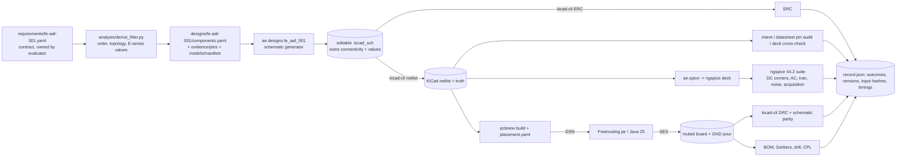

# Architecture (what exists today)

Contracts between stages are files (KiCad formats, YAML, JSON) plus the observed formats in `docs/data-contract.md`. Each external call goes through `ae.toolchain.run_in_image` / `run_router`
(named container, no network, kill on timeout, wall time + peak memory recorded). Failure modes: a stage returns `error`/`blocked` and dependants are marked `blocked`, not skipped silently.
**Not drawn because not built:** agents, orchestrator, patch review queue, evaluation harness (`docs/agentic-roadmap.md`).
